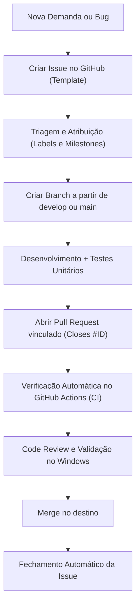

# Fluxo de Desenvolvimento, Ramificação e Deploy (Git & GitHub Workflow)

Este documento estabelece o modelo oficial de desenvolvimento contínuo, ciclo de vida de issues, política de branches e pipeline de deploy para o **PC Optimizer (Sollaris Nova)**.

---

## 1. Visão Geral da Estratégia de Branches

Adotamos um modelo híbrido derivado do **Git Flow** adaptado para produtos desktop modernos com suporte estendido (LTS) e versões de entrega contínua.

```mermaid
gitGraph
   commit id: "v0.1.0-setup"
   branch lts
   checkout main
   branch develop
   checkout develop
   branch feature/rf-001-cpu
   commit id: "feat: add cpu collector"
   commit id: "test: unit tests cpu"
   checkout develop
   merge feature/rf-001-cpu
   branch testing
   checkout testing
   merge develop
   commit id: "test: qa acceptance"
   checkout main
   merge testing id: "v0.1.0-mvp" tag: "v0.1.0"
   checkout lts
   merge main id: "sync lts"
   checkout main
   branch hotfix/fix-sensor
   commit id: "fix: sensor guard"
   checkout main
   merge hotfix/fix-sensor tag: "v0.1.1"
   checkout lts
   merge hotfix/fix-sensor
   checkout develop
   merge hotfix/fix-sensor
```

---

## 2. As Branches Principais (Permanentes)

| Branch | Finalidade | Regras de Proteção | Gatilhos de CI/CD |
| :--- | :--- | :--- | :--- |
| `main` | **Última versão estável / Produção.** Reflete o código em produção distribuível para usuários finais. | Bloqueado para commits diretos. Apenas PRs aprovados de `testing` ou `hotfix/*`. | Executa CI e dispara o Release Pipeline (pós-MVP). |
| `lts` | **Long-Term Support.** Mantém a versão com suporte estendido e estabilidade garantida, recebendo apenas correções críticas de segurança e compatibilidade. | Bloqueado para commits diretos. Apenas PRs de cherry-pick / backport de hotfixes. | Executa CI e gera builds de segurança LTS. |
| `testing` | **Homologação e Testes (Staging / QA).** Código pré-release integrado para testes manuais, baterias de benchmark e verificação de critérios de aceite do Windows. | Protegido contra commits diretos. Atualizado a partir de `develop` antes de cada lançamento. | Executa suíte completa de testes no Windows. |
| `develop` | **Integração de Desenvolvimento.** Ponto central de convergência do trabalho diário. É a branch mais dinâmica. | Protegido. Merges ocorrem exclusivamente via Pull Requests de `feature/*` e `bugfix/*`. | Executa CI a cada PR ou push. |

---

## 3. Branches de Apoio (Temporárias)

Todas as branches temporárias devem ser criadas a partir de uma branch de referência e deletadas após o merge do PR.

### 3.1 `feature/<id>-<descricao>`
- **Origem:** `develop` | **Destino:** `develop`
- **Exemplo:** `feature/RF-001-cpu-metrics`, `feature/issue-15-custom-sidebar`
- Utilizada para construir novas telas, coletores, componentes e serviços.

### 3.2 `fix/<issue-id>-<descricao>` ou `bugfix/...`
- **Origem:** `develop` | **Destino:** `develop`
- **Exemplo:** `fix/issue-22-process-access-denied`, `fix/issue-30-wmi-freeze`
- Utilizada para corrigir falhas descobertas durante o ciclo de desenvolvimento regular.

### 3.3 `hotfix/<versao>-<descricao>`
- **Origem:** `main` | **Destino:** `main`, `lts` e `develop`
- **Exemplo:** `hotfix/v0.1.1-crash-on-sensor-null`
- Utilizada para correções emergenciais críticas de código já distribuído.

### 3.4 `release/<versao>`
- **Origem:** `develop` | **Destino:** `testing` -> `main`
- **Exemplo:** `release/v0.1.0-mvp`, `release/v1.0.0`
- Utilizada para congelamento de código (feature freeze), bump de versão e ajustes finais de documentação antes de homologação.

---

## 4. Ciclo de Vida de Demandas e Tratamento em Issues

Nenhum desenvolvimento ou correção começa sem uma **Issue** aberta e documentada no GitHub.



### 4.1 Categorização de Issues (Labels Padronizadas)
- **Tipo:** `type:bug`, `type:feature`, `type:refactor`, `type:docs`, `type:performance`
- **Módulo:** `scope:core`, `scope:ui`, `scope:sensors`, `scope:diagnostics`, `scope:safety`
- **Prioridade:** `priority:critical`, `priority:high`, `priority:medium`, `priority:low`
- **Estado:** `status:in-progress`, `status:needs-review`, `status:blocked`

### 4.2 Regra de Ouro do Pull Request
Todo PR deve obrigatoriamente:
1. Usar o template em `.github/PULL_REQUEST_TEMPLATE.md`.
2. Conter a tag de fechamento da issue correspondente (ex: `Closes #42` ou `Fixes #18`).
3. Obter status verde no workflow de CI (`ruff` e `pytest`).
4. Atender a todos os critérios da **Definition of Done (DoD)** do projeto.

---

## 5. Estratégia de Versionamento (SemVer)

O projeto adota rigorosamente o **Semantic Versioning 2.0.0** (`MAJOR.MINOR.PATCH`):
- **MAJOR:** Mudanças que quebram compatibilidade estrutural, arquitetura de persistência ou versão de suporte do sistema operacional.
- **MINOR:** Novas funcionalidades seguras e compatíveis (ex.: adição de nova tela de limpeza ou novo perfil).
- **PATCH:** Correções de bugs, ajustes de estabilidade e sensores.

Durante a fase atual de construção do MVP, as versões seguem o esquema pré-release:
- `v0.1.0-alpha` (MVP em desenvolvimento)
- `v0.1.0` (Conclusão e validação do MVP)
- `v1.0.0` (Primeira versão pública estável com limpeza e perfis)

---

## 6. Fluxo de CI e Deploy com GitHub Actions

O pipeline de automação é dividido em dois estágios:

### 6.1 Estágio 1: CI Contínuo (Ativo desde o Início)
- **Arquivo:** `.github/workflows/ci.yml`
- **Gatilhos:** Pushes e Pull Requests direcionados a `develop`, `testing`, `main` e `lts`.
- **Ambiente:** `windows-latest` com **Python 3.14**.
- **Ações:**
  1. Instalação limpa de dependências via `requirements-dev.txt`.
  2. Execução de lint e formatação estrita via `ruff check .`.
  3. Execução da suíte completa de testes via `pytest -v`.

### 6.2 Estágio 2: Deploy / CD e Empacotamento de Releases (Pós-MVP)
- **Arquivo:** `.github/workflows/release-build.yml`
- **Gatilho:** Criação de tags de versão (`v*.*.*`) após a conclusão da Fase 6 do MVP.
- **Ações:**
  1. Compilação do binário standalone `.exe` para Windows 10/11 utilizando o PyInstaller.
  2. Validação da assinatura e hash SHA-256 do executável gerado.
  3. Criação automática de Release no GitHub com changelog correspondente e anexo do instalador/executável compactado.
  4. Publicação na branch de distribuição e arquivo de artefatos.
